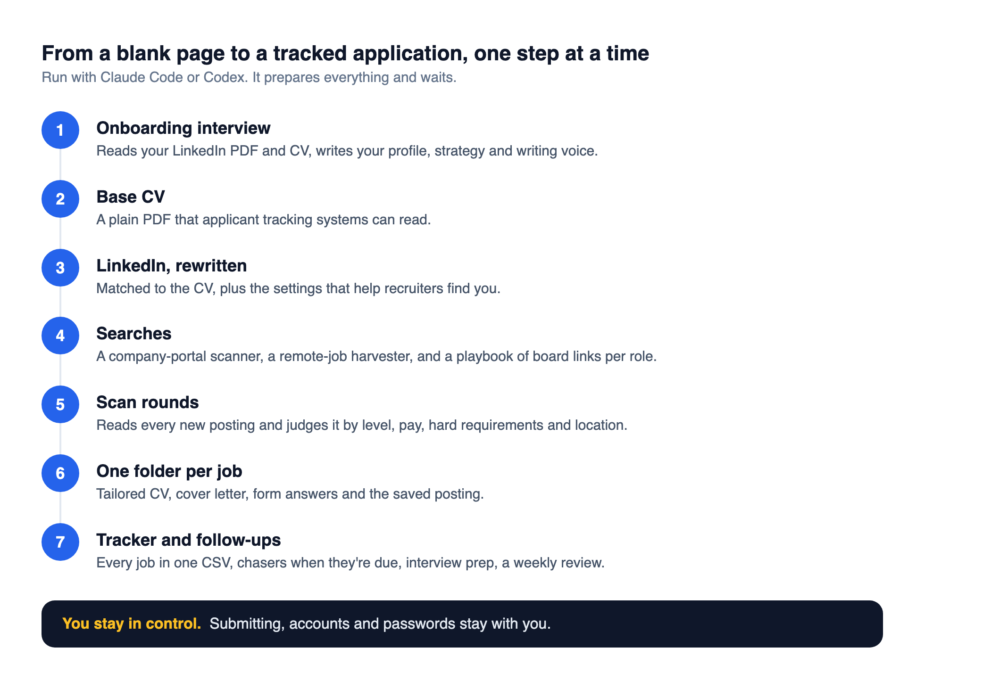

<div align="center">

# 🧭 Job search kit

### A job search run with Claude Code or Codex: an intake interview, tailored CVs, scan rounds, a folder per application and a tracker. Your data never leaves your machine.

[](#getting-started)
[](#getting-started)
[](https://claude.com/claude-code)
[](LICENSE)

<br>



</div>

---

It gives anyone looking for work a full structure, from onboarding to follow-ups. It prepares everything and waits; submitting, accounts and passwords stay with you.

## Getting started

You need Python 3.9+, Node 18+ and Claude Code or Codex.

```bash
git clone https://github.com/diego-salomon/job-search-kit.git
cd job-search-kit
python3 -m pip install -r requirements.txt
claude          # or: codex
```

Say "start". Have your LinkedIn PDF (your profile, More, Save to PDF) and your CV at hand.

## What's inside

```
.claude/skills/   one skill per step (plain Markdown, readable by any agent)
tools/
  scan_portals.py   job APIs of Greenhouse, Ashby, Lever, Workable, Recruitee, SmartRecruiters
  harvest_remote.py remote boards, sorted into worldwide, eligible for your region, unknown and region-locked
  ats-score.mjs     requirement words from the posting that your CV never mentions
  make_cv.py        cv.md and cover-letter.md to PDF
  tracker.py        the tracker, a CSV you can open in Excel or Sheets
templates/        profile, strategy, voice, CV, cover letter, playbook
search/           search config
me/  applications/  scans/   your data. Ignored by git.
```

The tools also work on their own:

```bash
python3 tools/harvest_remote.py --keyword "operations,coordinator" --region "europe" --out scans/remote.csv
python3 tools/scan_portals.py --probe gitlab,zapier
node tools/ats-score.mjs applications/acme/posting.txt applications/acme/cv.md
python3 tools/tracker.py add --company Acme --role "Operations Specialist" --link https://...
python3 tools/tracker.py due
```

## Good to know

- Search broad and judge by reading the posting, not the title.
- A job qualifies when the top of its pay range reaches your floor.
- Most "remote" jobs on free boards are locked to one country; the harvester treats any named place as a restriction.
- Apply within days. Postings fill fast.
- Companies on Workday or SuccessFactors can't be scanned through a public API; keep them as links in the playbook.

---

<div align="center">
<sub>Built by <a href="https://github.com/diego-salomon">Diego Salomón</a>. · <a href="https://www.linkedin.com/in/diegosalomon">LinkedIn</a></sub>
</div>
